# Multi-Tenant Integration Adapter Platform: Architecture & Operator Guide

## 1. Overview & Architecture

The **Multi-Tenant Integration Adapter Platform** enables the AI Receptionist to connect to third-party telephony carriers, calendar engines, appointment platforms, table reservation managers, CRMs, messaging channels, payment gateways, and support desks without tight coupling.

### Key Tenets

1. **Provider Independence**: The AI agent never receives vendor-specific JSON payloads. All interactions occur through stable capability contracts (`check_availability`, `create_booking`, `send_message`, `create_payment_request`, etc.).
2. **Authoritative Source-of-Truth**: Each capability is assigned a single authoritative source of truth (`AuthoritativeSource.BUILTIN_DATABASE`, `AuthoritativeSource.EXTERNAL_CALENDAR`, `AuthoritativeSource.PAYMENT_GATEWAY`, etc.). Systems with conflicting semantics are never silently merged.
3. **Truthful Outcomes**: The system strictly differentiates among `OPERATION_COMPLETED`, `OPERATION_PENDING`, `BUSINESS_REJECTION`, `OUTCOME_UNKNOWN`, and `OPERATION_FAILED`. It never claims a payment succeeded when only a payment link was generated.
4. **Tenant Boundary & Security**: Credentials are encrypted at rest with AES-256 envelope encryption. Plaintext secrets are never logged, returned over the API, or displayed in the dashboard.
5. **Reliability & Idempotency**: Bounded timeouts, exponential backoff with jitter, HTTP `Retry-After` adherence, deduplicated webhooks, and ambiguous outcome handling protect external systems against duplicate bookings or duplicate charges.

---

## 2. Capability Contracts Catalog

Located in `backend/integrations/contracts.py`:

| Capability                    | Category        | Side Effect            | Idempotent | Timeout | Authoritative Source   |
| :---------------------------- | :-------------- | :--------------------- | :--------- | :------ | :--------------------- |
| `check_availability`        | `RESERVATION` | `READ_ONLY`          | Optional   | 8.0s    | Built-in DB / Calendar |
| `create_booking`            | `RESERVATION` | `IDEMPOTENT_WRITE`   | Required   | 10.0s   | Built-in DB / Calendar |
| `get_booking`               | `RESERVATION` | `READ_ONLY`          | Optional   | 5.0s    | Booking Store          |
| `reschedule_booking`        | `RESERVATION` | `IDEMPOTENT_WRITE`   | Required   | 10.0s   | Booking Store          |
| `cancel_booking`            | `RESERVATION` | `IDEMPOTENT_WRITE`   | Optional   | 10.0s   | Booking Store          |
| `create_calendar_event`     | `CALENDAR`    | `IDEMPOTENT_WRITE`   | Required   | 10.0s   | External Calendar      |
| `get_customer`              | `CRM`         | `READ_ONLY`          | Optional   | 5.0s    | CRM System             |
| `create_or_update_customer` | `CRM`         | `IDEMPOTENT_WRITE`   | Required   | 8.0s    | CRM System             |
| `send_message`              | `MESSAGING`   | `IRREVERSIBLE_WRITE` | Required   | 8.0s    | Messaging Provider     |
| `send_email`                | `MESSAGING`   | `IRREVERSIBLE_WRITE` | Required   | 8.0s    | Messaging Provider     |
| `initiate_call`             | `TELEPHONY`   | `IRREVERSIBLE_WRITE` | Required   | 10.0s   | Telephony Carrier      |
| `transfer_call`             | `TELEPHONY`   | `IRREVERSIBLE_WRITE` | Required   | 8.0s    | Telephony Carrier      |
| `get_call_status`           | `TELEPHONY`   | `READ_ONLY`          | Optional   | 5.0s    | Telephony Carrier      |
| `create_support_ticket`     | `SUPPORT`     | `IDEMPOTENT_WRITE`   | Required   | 8.0s    | Support Desk           |
| `get_payment_status`        | `PAYMENT`     | `READ_ONLY`          | Optional   | 5.0s    | Payment Gateway        |
| `create_payment_request`    | `PAYMENT`     | `IRREVERSIBLE_WRITE` | Required   | 10.0s   | Payment Gateway        |

---

## 3. Provider Manifests & Setup Requirements

### 1. Built-in Dining Table Manager (`builtin_dining`)

- **Authoritative Source**: `BUILTIN_DATABASE`
- **Setup Fields**: `reservation_duration_minutes` (int, default 90), `max_party_size` (int, default 10).
- **Required Resources**: At least one active `table` resource registered in the business tenant's inventory.
- **Limitations**: Does not sync automatically with third-party restaurant POS terminals.

### 2. Built-in Clinical Scheduler (`builtin_clinic`)

- **Authoritative Source**: `BUILTIN_DATABASE`
- **Setup Fields**: `slot_duration_minutes` (int, default 30).
- **Required Resources**: At least one active `room` (consultation suite) in the business tenant's inventory.
- **Limitations**: Independent from hospital EHR/Epic systems.

### 3. Google Calendar (`google_calendar`)

- **Authoritative Source**: `EXTERNAL_CALENDAR`
- **Auth Method**: `SERVICE_ACCOUNT`
- **Required Scopes**:
  - `https://www.googleapis.com/auth/calendar.events`
  - `https://www.googleapis.com/auth/calendar.readonly`
- **Console Setup**:
  1. In Google Cloud Console, enable **Google Calendar API**.
  2. Create a Service Account in IAM & Admin.
  3. Generate a JSON private key and paste it into `service_account_json`.
  4. Share the target Google Calendar with the service account client email (`...iam.gserviceaccount.com`) granting "Make changes to events" permission.
- **Known Limitations**: Google Calendar API rate limits (500 requests per 100 seconds per user).

### 4. Exotel Telephony (`exotel`)

- **Authoritative Source**: `TELEPHONY_CARRIER`
- **Auth Method**: API Key & Token + Account SID.
- **Webhook Endpoint**: `POST /api/webhooks/exotel`
- **Signature Algorithm**: HMAC-SHA256 of raw request body signed with `EXOTEL_WEBHOOK_SECRET`, verified against `X-Exotel-Signature`.
- **Known Limitations**: Live call transfers require active PSTN routing rules configured in the Exotel Applet builder.

### 5. Twilio Messaging (`twilio`)

- **Authoritative Source**: `MESSAGING_PROVIDER`
- **Auth Method**: Account SID & Auth Token.
- **Webhook Endpoint**: `POST /api/webhooks/twilio`
- **Signature Algorithm**: HMAC-SHA1 of full webhook URL plus sorted parameter key-value pairs signed with Auth Token, verified against `X-Twilio-Signature`.
- **Known Limitations**: Outbound SMS to US numbers requires A2P 10DLC brand and campaign registration.

### 6. Stripe Payments (`stripe`)

- **Authoritative Source**: `PAYMENT_GATEWAY`
- **Auth Method**: Secret Key (`sk_live_...` or `sk_test_...`).
- **Webhook Endpoint**: `POST /api/webhooks/stripe`
- **Signature Algorithm**: Stripe HMAC-SHA256 matching `t=timestamp,v1=signature`. Enforces a strict 300-second replay window tolerance.
- **Known Limitations**: Payment link creation returns `OPERATION_PENDING`. Payment is only marked `OPERATION_COMPLETED` once the `checkout.session.completed` webhook fires.

### 7. HubSpot CRM (`hubspot`)

- **Authoritative Source**: `CRM_SYSTEM`
- **Auth Method**: Private App Access Token (`pat-...`).
- **Scopes**: `crm.objects.contacts.read`, `crm.objects.contacts.write`.
- **Known Limitations**: Standard HubSpot API rate limit of 100 requests per 10 seconds.

### 8. Zendesk Support (`zendesk` / `zendesk_support`)

- **Authoritative Source**: `AuthoritativeSource.SUPPORT_DESK`
- **Supported Capabilities**:
  - `CREATE_SUPPORT_TICKET`: Customer escalation ticket creation and status tracking via official Zendesk REST API (v2).
- **Official API Endpoint**: `https://{subdomain}.zendesk.com/api/v2/...`
- **Authentication**:
  - **OAuth 2.0 (Preferred for multi-tenant SaaS)**: Bearer access token generated via Authorization Code flow (`/oauth/authorizations/new` & `/oauth/tokens`) with scopes `read write tickets:read tickets:write users:read`.
  - **API Token (Alternative option)**: Basic authentication using `{email}/token:{api_token}`.
- **Progressive Capability Gating**:
  - Core features enabled by default: `ticket_creation`, `ticket_retrieval`.
  - Extended capabilities require tenant configuration enablement in `enabled_features`:
    * `ticket_updates`: Edit ticket status, priority, or tags.
    * `comments`: Append public or internal agent replies.
    * `assignment`: Assign tickets to agents (`assignee_id`) or groups (`group_id`).
    * `user_lookup`: Search and retrieve user and organization details.
- **Ambiguous Timeout Reconciliation & Deduplication**:
  - Sets deterministic `external_id` on all tickets (`POST /api/v2/tickets.json`).
  - If a timeout occurs or retry is scheduled, the adapter searches Zendesk first (`GET /search.json?query=type:ticket external_id:{id}`) to recover created tickets without duplicating requests.
- **Archived Ticket Handling**:
  - Acknowledges Zendesk's ~120-day automatic ticket archiving after closure.
  - Guards against invalid write attempts on archived tickets, surfacing clear `BUSINESS_RULE_VIOLATION` errors.
- **Truthful Outcome Envelopes**:
  - Stores real provider ticket reference (`ticket_id` and `provider_ticket_id: zen_{id}`).
  - Strictly does not report tickets as resolved until authoritative Zendesk state confirms `status in ('solved', 'closed')`.
- **Rate-Limiting & Credit Consumption**:
  - Adheres to Zendesk plan limits (Suite Team: 200 RPM, Professional: 400 RPM, Enterprise: 700 RPM).
  - Normalizes HTTP 429 with `Retry-After` backoff into `ErrorCategory.RATE_LIMITED`.
- **Safe Diagnostics**:
  - `test_connection()` safely probes `GET /api/v2/users/me.json` to verify authentication without creating dummy tickets.

### 9. Microsoft 365 / Outlook Calendar (`outlook_calendar`)

- **Authoritative Source**: `EXTERNAL_CALENDAR`
- **Auth Method**: OAuth 2.0 (Microsoft Entra ID / Microsoft Graph v1.0).
- **API Endpoint**: `https://graph.microsoft.com/v1.0`
- **Delegated vs Application Permissions**:
  - **Delegated Access (Recommended / Least Privilege)**:
    - User signs in with their Microsoft account.
    - Scopes: `Calendars.Read` (availability & read-only) or `Calendars.ReadWrite` (booking CRUD), `User.Read`, `offline_access`.
    - Never requests broad, organization-wide access by default.
  - **Application Access (Client Credentials)**:
    - Used only when justified by business requirement for daemon headless access to multiple employee mailboxes.
    - Requires Entra ID tenant administrator consent. Uses `/users/{user_id}/...` endpoints rather than `/me/...`.
- **Entra ID App Registration**:
  1. Register app in **Microsoft Entra ID admin center** under *App registrations*.
  2. Supported account types: *Accounts in any organizational directory (Multitenant) and personal Microsoft accounts*.
  3. Configure Redirect URI (Web): `https://your-domain.com/api/auth/microsoft/callback`.
  4. Under *API permissions*, add Microsoft Graph delegated permissions (`Calendars.Read`, `Calendars.ReadWrite`, `User.Read`, `offline_access`).
- **Availability Lookup Architecture (`getSchedule` vs `calendarView`)**:
  - **Work/School Accounts (Entra ID)**: Calls `POST /v1.0/me/calendar/getSchedule` with availability view interval. Returns free/busy slots.
  - **Personal Microsoft Accounts (Outlook.com / Hotmail)**: Automatically falls back to `/v1.0/me/calendars/{id}/calendarView` because personal accounts do not support `getSchedule`.
- **Duplicate Event Safeguards**:
  - Sets native Microsoft Graph `transactionId` on all created calendar events (`POST /v1.0/me/events` with `"transactionId": idempotency_key`). Microsoft Graph automatically deduplicates event creation requests carrying the same client transaction ID.
- **Timezone Safety**:
  - Request header `Prefer: outlook.timezone="UTC"` (or configured business timezone).
  - Explicit `timeZone` field in `start` and `end` JSON objects.
- **Throttling & Error Normalization**:
  - Honors HTTP 429 `Retry-After` response header.
  - Normalizes Graph error codes (`ErrorItemNotFound`, `ErrorAccessDenied`, `ErrorThrottled`, `InvalidAuthenticationToken`).
- **Token Refresh & Revoked Consent**:
  - Refreshes tokens via `https://login.microsoftonline.com/{tenant_id}/oauth2/v2.0/token`.
  - Gracefully detects consent revocation (`invalid_grant`, `AADSTS65001`) and transitions status to `needs_input` or `awaiting_authorization`.

### 10. OpenTable Partner Reservation Network (`opentable`)

- **Authoritative Source**: `EXTERNAL_RESERVATION_SYSTEM`
- **Auth Method**: Partner ID (`X-OT-Partner-ID`) & Bearer API Key (`Authorization: Bearer <key>`).
- **Endpoints**:
  - Sandbox: `https://sandbox-api.opentable.com/v2`
  - Production: `https://api.opentable.com/v2`
- **Partner Gating & Approval Prerequisite**:
  - OpenTable's Consumer API v2 is **strictly partner-gated**. Third-party applications cannot query live table inventory or commit reservations without a formal OpenTable Integration Partner Agreement.
  - Setup wizard strictly distinguishes `pending_provider_approval` from `ready`.
  - If `partner_approved` is `False`, the adapter marks readiness as `pending_provider_approval` with `is_ready=False` and blocks live reservation execution (`PERMISSION_DENIED`).
  - **Zero Guessing / No Scraping Guarantee**: Under no circumstances does CallMe substitute guessed endpoints, scraped HTML, or the local built-in booking database for OpenTable live inventory while claiming to use OpenTable.
- **Documented Partner Approval Checklist**:
  1. **Commercial Agreement**: Execute official Integration Partner Program contract with OpenTable Partner Network.
  2. **Partner ID & Key Provisioning**: Obtain production/sandbox Partner ID and Consumer API v2 secret key.
  3. **Restaurant Authorization (RID)**: Restaurant owner must authorize partner integration inside OpenTable GuestCenter for their Restaurant ID (`rid`).
  4. **Sandbox Certification**: Pass partner test suite validation against `sandbox-api.opentable.com` before production switch.
- **Consumer API v2 Schema & Data Mapping**:
  - **Local Date/Time**: Format `YYYY-MM-DDTHH:MM` (ISO without timezone offset, representing restaurant local clock time).
  - **Party Size**: Integer diner count (constrained to restaurant bookable limits).
  - **Seating Preferences**: Mapped to OpenTable seating area codes (`Default`, `Outdoor`, `Bar`, `Window`).
  - **Restaurant Identifiers**: OpenTable numeric restaurant ID (`rid`).
- **Idempotency & Request Safeguards**:
  - Every write request sends header `X-OT-Request-Id` using the platform correlation ID or idempotency key.
  - Prevents double-booking if downstream commits experience transient socket resets or packet drops.
- **Error Normalization**:
  - HTTP 429 / `rate_limit_exceeded` / `throttled` -> `ErrorCategory.RATE_LIMITED` (`is_retryable=True`).
  - HTTP 400 / `slot_unavailable` / `no_availability` -> `ErrorCategory.CONFLICT` (`is_retryable=False`).
  - HTTP 401 / 403 / unapproved partner -> `ErrorCategory.PERMISSION_DENIED` (`is_retryable=False`).
  - HTTP 404 / `reservation_not_found` -> `ErrorCategory.RESOURCE_NOT_FOUND` (`is_retryable=False`).

### 11. SevenRooms Reservation & Guest-Management Engine (`sevenrooms` / `external_sevenrooms`)

- **Authoritative Source**: `EXTERNAL_RESERVATION`
- **Auth Method**: Bearer API Key (`Authorization: Bearer <key>`) or OAuth 2.0 Client Credentials (`client_id`, `client_secret`).
- **Endpoints**:
  - US Production: `https://api.sevenrooms.com/2_4`
  - EU Production: `https://api.eu.sevenrooms.com/2_4`
- **Partner Gating & Access Rules**:
  - SevenRooms developer documentation and REST API endpoints are **individually provisioned and partner-gated** (`api-integration-support@sevenrooms.com` / `api-docs.sevenrooms.com`).
  - If `partner_approved` is `False`, the adapter marks readiness as `pending_provider_approval` with `is_ready=False` and blocks live reservation execution (`PERMISSION_DENIED`).
  - **No Fabrication / Built-in Alternative Guarantee**: Under no circumstances does CallMe fabricate a working SevenRooms connection, scrape HTML, or query the built-in database under the SevenRooms name. If external access is not available, the platform offers the **Built-in Table & Capacity Manager** (`builtin_dining`) as an independent, transparent option.
- **Documented Partner Approval Checklist**:
  1. **Commercial Agreement**: Execute partnership or venue API access agreement with SevenRooms.
  2. **Developer Credentials Provisioning**: Obtain Client ID, Client Secret, or Bearer API Key from SevenRooms Developer Portal (`api-docs.sevenrooms.com`).
  3. **Venue Configuration & Authorization**: Target restaurant location must authorize API access for its specific `venue_id` in SevenRooms Console.
  4. **Cluster Endpoint Verification**: Validate network reachability against the regional data residency cluster (`api.sevenrooms.com/2_4` or `api.eu.sevenrooms.com/2_4`).
- **Supported Operations & Payload Formats**:
  - **Availability Query (`POST /2_4/availability`)**: Passes `venue_id`, `party_size`, `date` (`YYYY-MM-DD`), `time` (`HH:MM`), and optional `seating_area`. Returns accessible timeslots with cover limits.
  - **Reservation Creation (`POST /2_4/reservations`)**: Passes `venue_id`, `datetime` (`YYYY-MM-DDTHH:MM`), `party_size`, `guest` (`first_name`, `last_name`, `phone`, `email`), `client_request_notes`, and `client_reference_id` / `X-Request-Id` for idempotency.
  - **Reservation Retrieval (`GET /2_4/reservations/{reservation_id}`)**: Fetches booking status, guest CRM profile, and party details.
  - **Reschedule / Modification (`PATCH /2_4/reservations/{reservation_id}`)**: Updates date/time and party size.
  - **Cancellation (`DELETE /2_4/reservations/{reservation_id}`)**: Releases table inventory.
- **Rate Limits & Webhooks**:
  - Rate limit: 120 requests per minute per venue API token.
  - Webhooks: Real-time event notifications for `reservation.created`, `reservation.updated`, `reservation.cancelled`, and `guest.updated`.
- **Error Normalization**:
  - HTTP 429 / `rate_limit` / `throttled` -> `ErrorCategory.RATE_LIMITED` (`is_retryable=True`).
  - HTTP 400 / `slot_unavailable` / `pacing` -> `ErrorCategory.CONFLICT` (`is_retryable=False`).
  - HTTP 401 / 403 / `unauthorized` / `invalid_token` -> `ErrorCategory.PERMISSION_DENIED` (`is_retryable=False`).
  - HTTP 404 / `not_found` -> `ErrorCategory.RESOURCE_NOT_FOUND` (`is_retryable=False`).

### 12. Acuity Scheduling Appointment Adapter (`acuity` / `acuity_scheduling`)

- **Authoritative Source**: `EXTERNAL_CALENDAR`
- **Auth Method**:
  - **Single Account**: HTTP Basic Auth with numeric User ID as username and secret API Key as password (`Authorization: Basic base64(user_id:api_key)`).
  - **Multi-Account App Integrations**: OAuth 2.0 Bearer token (`Authorization: Bearer <access_token>`).
- **Endpoint**:
  - Official REST API v1: `https://acuityscheduling.com/api/v1`
- **Security & Envelope Encryption**:
  - Master key envelope encryption with AES-256-GCM.
  - User ID is validated as numeric format.
  - Secret API Key and OAuth2 Access Token are marked `secret=True` and redacted in logs, diagnostics, and frontend state payloads (`sk_...` / `masked`).
- **Resource Discovery**:
  - Calendars (`GET /calendars`): Discovers staff members, doctors, consultants, or treatment rooms.
  - Appointment Types (`GET /appointment-types`): Discovers services, durations, pricing, and category IDs.
- **Availability Lookup (No Inferring from Existing Bookings)**:
  - Live availability endpoint verification against Acuity's real-time scheduling rules:
    - Step 1: `GET /availability/dates?month=YYYY-MM&appointmentTypeID=...&calendarID=...&timezone=...`
    - Step 2: `GET /availability/times?date=YYYY-MM-DD&appointmentTypeID=...&calendarID=...&timezone=...`
  - Under no circumstances does CallMe infer slot availability by subtracting appointments from working hours; Acuity's live booking rules, buffers, and calendar blocks are authoritative.
- **Appointment Lifecycle Operations**:
  - **Create (`POST /appointments`)**: Submits appointment type, formatted ISO-8601 datetime with timezone offset, customer details (`firstName`, `lastName`, `email`, `phone`), and notes with embedded idempotency token.
  - **Separation of Confirmed vs Pending Appointments**:
    - Returned appointments with status `confirmed` are marked `ExecutionOutcome.OPERATION_COMPLETED`.
    - Returned appointments with status `pending`, `unconfirmed`, or `awaiting_payment` are explicitly marked `ExecutionOutcome.OPERATION_PENDING` with safe user explanation.
  - **Lookup (`GET /appointments/{id}`)**: Queries authoritative appointment details and status.
  - **Reschedule (`PUT /appointments/{id}/reschedule`)**: Updates appointment datetime and optionally practitioner calendar.
  - **Cancellation (`PUT /appointments/{id}/cancel?admin=true`)**: Releases calendar slot with audit cancel note.
- **Webhook Signature Verification**:
  - Header: `x-acuity-signature`
  - Algorithm: Base64-encoded HMAC-SHA256 signature calculated over raw request body using secret `api_key`.
  - Events supported: `appointment.scheduled`, `appointment.rescheduled`, `appointment.canceled`, `appointment.changed`.
  - Replay deduplication: Deterministic event keys (`acuity_{action}_{appointment_id}`) stored in replay cache.
- **Error Normalization**:
  - HTTP 429 / `rate_limit` -> `ErrorCategory.RATE_LIMITED` (`is_retryable=True`).
  - HTTP 400 / `error: "conflict"` / `slot_unavailable` -> `ErrorCategory.CONFLICT` (`is_retryable=False`).
  - HTTP 401 / `unauthorized` -> `ErrorCategory.INVALID_CREDENTIALS` (`is_retryable=False`).
  - HTTP 403 / `forbidden` -> `ErrorCategory.PERMISSION_DENIED` (`is_retryable=False`).
  - HTTP 404 / `not_found` -> `ErrorCategory.RESOURCE_NOT_FOUND` (`is_retryable=False`).

### 13. Square Bookings & Appointments Engine (`square` / `square_bookings`)

- **Authoritative Source**: `EXTERNAL_CALENDAR`
- **Auth Method**: OAuth 2.0 Bearer Token (`Authorization: Bearer <access_token>`).
- **Least-Privilege Scopes**:
  - `APPOINTMENTS_READ`: Query bookings, appointments, and availability.
  - `APPOINTMENTS_WRITE`: Create, reschedule, and cancel appointment bookings.
  - `APPOINTMENTS_BUSINESS_SETTINGS_READ`: Verify seller booking profile and online booking eligibility.
  - `MERCHANT_PROFILE_READ`: Retrieve merchant account details.
  - `CUSTOMERS_READ` & `CUSTOMERS_WRITE`: Resolve or create customer profiles for appointments.
  - `ITEMS_READ`: Read catalog service variations, durations, and pricing.
- **Endpoints**:
  - Production: `https://connect.squareup.com` (Square API 2024-01-18 / current SDK v46+)
  - Sandbox: `https://connect.squareupsandbox.com`
- **Seller Eligibility & Feature Gating**:
  - Validates merchant eligibility via `client.bookings.get_business_profile()`.
  - Verifies `booking_enabled` is active before enabling live capabilities.
  - Validates active business locations (`client.locations.list()`) and bookable catalog service variations.
  - Does not assume all sellers have appointments enabled; gracefully flags missing features or ungranted scopes.
- **Resource Discovery**:
  - Locations (`GET /v2/locations`): Discovers business locations, operating status, and timezones.
  - Catalog Services (`GET /v2/catalog/list?types=ITEM_VARIATION`): Discovers bookable service variations, durations, and pricing.
  - Team Members (`GET /v2/bookings/team-member-booking-profiles`): Discovers staff members and bookable practitioners.
- **Availability Search (No Inference)**:
  - Invokes `POST /v2/bookings/availability/search` with `start_at_range`, `location_id`, and `segment_filters`.
  - Verifies real-time practitioner schedules, breaks, and buffer intervals.
  - Never infers availability by subtracting appointments from working hours.
- **Appointment Lifecycle Operations**:
  - **Create (`POST /v2/bookings`)**: Resolves/creates Square customer, assigns service variation and team member, sets `idempotency_key`, and records version.
  - **Separation of Statuses**:
    - `ACCEPTED` -> `ExecutionOutcome.OPERATION_COMPLETED`.
    - `PENDING` (seller requires manual approval) -> explicitly marked `ExecutionOutcome.OPERATION_PENDING`.
    - `DECLINED` / `CANCELLED_BY_SELLER` -> `ExecutionOutcome.BUSINESS_REJECTION`.
  - **Retrieval (`GET /v2/bookings/{booking_id}`)**: Queries authoritative appointment details and current `version`.
  - **Reschedule / Update (`PUT /v2/bookings/{booking_id}`)**: Updates `start_at` or segments with version locking to prevent concurrency collisions.
  - **Cancellation (`POST /v2/bookings/{booking_id}/cancel`)**: Releases slot with `booking_version` and idempotency key.
- **Concurrency & Version Conflict Safeguards**:
  - Square requires current integer `version` on all write updates.
  - If a concurrent user or session modified the booking, Square returns `409 Conflict` (`VERSION_MISMATCH`). The adapter maps this to `ErrorCategory.CONFLICT` with safe retry/refresh guidance.
- **Webhook Signature Verification**:
  - Header: `x-square-hmacsha256-signature`
  - Algorithm: Base64 HMAC-SHA256 calculated over `notification_url + raw_body` using secret `webhook_signature_key`.
  - Events supported: `booking.created`, `booking.updated`, `booking.canceled`.
  - Replay deduplication: Deterministic event keys (`square_{type}_{booking_id}_v{version}`).
- **Error Normalization**:
  - HTTP 429 / `RATE_LIMITED` -> `ErrorCategory.RATE_LIMITED` (`is_retryable=True`).
  - HTTP 409 / `VERSION_MISMATCH` / conflict -> `ErrorCategory.CONFLICT` (`is_retryable=False`).
  - HTTP 401 / `UNAUTHORIZED` -> `ErrorCategory.AUTHENTICATION_FAILED` (`is_retryable=False`).
  - HTTP 403 / `NOT_AUTHORIZED` -> `ErrorCategory.PERMISSION_DENIED` (`is_retryable=False`).
  - HTTP 404 / `NOT_FOUND` -> `ErrorCategory.RESOURCE_NOT_FOUND` (`is_retryable=False`).

---

## 4. Tenant Integration Lifecycle State Machine

Integrations cycle through 9 deterministic states:

```mermaid
stateDiagram-v2
    [*] --> not_configured
    not_configured --> needs_input: Configure integration
    needs_input --> validating: Provide required fields
    validating --> ready: Connection tests & resource checks pass
    validating --> failed: Credentials or syntax checks fail
    validating --> pending_provider_approval: Awaiting partner approval
    pending_provider_approval --> ready: Partner approval confirmed
    ready --> degraded: Intermittent downstream failures
    degraded --> ready: Downstream health restored
    degraded --> failed: Terminal error / revoked keys
    ready --> disconnected: Tenant initiates disconnect
    failed --> needs_input: Re-enter credentials
```

---

## 5. Security Architecture

1. **Envelope Encryption**:
   - Master key derived via SHA-256 (`CAPABILITY_ENCRYPTION_KEY`).
   - Tenant credentials encrypted with AES-256-GCM generating unique 12-byte IVs.
   - Keys and tokens are masked deterministically (`sk_live_...4829`) when serialized in metadata.
2. **Tenant Isolation**:
   - Every read and write validates tenant `business_id` server-side.
   - Cross-tenant tool resolution or configuration tampering returns `PERMISSION_DENIED`.
3. **Webhook Replay Deduplication**:
   - Webhook event IDs are deduplicated in the audit store.
   - Duplicate events are logged and acknowledged (`200 OK`) without triggering duplicate state changes.

---

## 6. Execution Safety & Ambiguous Timeout Handling

For irreversible operations (payments, messages, call transfers):

- **Exponential Backoff**: Safe retry on HTTP 429/503 up to bounded limits.
- **Retry-After**: Adheres to downstream provider backoff headers.
- **Ambiguous Outcome Handling**: If a network timeout occurs while awaiting confirmation of a write operation, the adapter returns `ExecutionOutcome.OUTCOME_UNKNOWN` with `is_retryable=False`. This prevents the agent or retry loop from firing a duplicate charge or reservation.

---

## 7. Sandbox Testing & Production Readiness Checklist

Before activating integrations for live production tenants:

- [X] Configure `CAPABILITY_ENCRYPTION_KEY` in environment.
- [X] Register provider webhook endpoints with HTTPS reverse proxy.
- [X] Ensure tenant has provisioned reservable inventory (tables or suites) before enabling booking capabilities.
- [X] Verify partner access approval flags for enterprise providers.
- [X] Validate webhook signature secrets in provider developer portals.

---

## 14. HubSpot CRM Adapter (`hubspot` / `hubspot_crm`)

- **Authoritative Source**: `AuthoritativeSource.CRM_SYSTEM`
- **Official SDK**: `hubspot-api-client` (v12.x) / HubSpot CRM API v3/v4
- **Supported Capabilities**:
  - `GET_CUSTOMER`: Contact lookup and search by email, phone, or ID.
  - `CREATE_OR_UPDATE_CUSTOMER`: Contact creation or update with configurable deduplication.
- **Authentication**:
  - `AuthMethod.OAUTH2`: Multi-tenant authorization flow (`/oauth/authorize`, `/oauth/v1/token`) with automatic token refresh.
  - `AuthMethod.BEARER_TOKEN`: Private App Access Tokens (`pat-na1-...`).
- **Least-Privilege Scopes**:
  - Core: `crm.objects.contacts.read`, `crm.objects.contacts.write`
  - Notes: `crm.objects.notes.read`, `crm.objects.notes.write`
  - Tasks: `crm.objects.tasks.read`, `crm.objects.tasks.write`
  - Deals: `crm.objects.deals.read`, `crm.objects.deals.write`
  - Schema: `crm.schemas.contacts.read`
- **Configurable Deduplication Matching Strategy**:
  - `email_then_phone` (default): Checks email first; if not found, checks normalized phone.
  - `email_only`: Strict match on email only.
  - `phone_only`: Strict match on normalized phone only.
  - `email_and_phone`: Requires both email and phone to match.
  - **Strict Deduplication Safeguard**: Contacts are **never** merged solely based on matching names.
- **Resilience Against Missing Custom Properties**:
  - Dynamically discovers portal contact properties (`discover_resources("properties")`).
  - Gracefully omits unknown custom properties on 400 `INVALID_PROPERTY` and retries without failing the contact creation.
- **Associations & Engagements**:
  - Associates contacts with companies, deals, notes, and tasks via HubSpot CRM v4 Associations API (`client.crm.associations.v4.basic_api.create_default`).
- **Rate-Limiting & Error Normalization**:
  - Handles HTTP 429 (`RATE_LIMITED` with `is_retryable=True` and `Retry-After` adherence).
  - Normalizes 401 (`AUTHENTICATION_FAILED`), 403 (`PERMISSION_DENIED`), 404 (`RESOURCE_NOT_FOUND`), 409 (`CONFLICT`), and 400 (`VALIDATION_ERROR`).
- **Provider ID Normalization**:
  - Normalizes IDs (e.g. `hs_contact_101` -> `101`) consistently.

## 15. Zoho CRM Adapter (`zoho` / `zoho_crm`)

- **Authoritative Source**: `AuthoritativeSource.CRM_SYSTEM`
- **Supported Capabilities**:
  - `GET_CUSTOMER`: Contact and lead search and record retrieval by email, phone, or record ID.
  - `CREATE_OR_UPDATE_CUSTOMER`: Contact and lead creation, update, and upsert with configurable deduplication.
- **API Version**: Current Zoho CRM API v6 (`/crm/v6/...`).
- **Global Multi-Region Data Centers**:
  - US (`us`): `accounts.zoho.com` / `zohoapis.com`
  - EU (`eu`): `accounts.zoho.eu` / `zohoapis.eu`
  - IN (`in`): `accounts.zoho.in` / `zohoapis.in`
  - AU (`au`): `accounts.zoho.com.au` / `zohoapis.com.au`
  - JP (`jp`): `accounts.zoho.jp` / `zohoapis.jp`
  - CN (`cn`): `accounts.zoho.com.cn` / `zohoapis.com.cn`
  - CA (`ca`): `accounts.zohocloud.ca` / `zohoapis.ca`
  - Dynamic `api_domain` extraction during OAuth token exchange overrides regional default URLs.
- **Organization-Specific Authorization & Strict Cross-Org Token Isolation**:
  - `X-CRM-ORG: {org_id}` header supplied on all API requests.
  - Active organization verification prevents an access token generated for one Zoho organization or environment from being used against another.
- **Least-Privilege Scopes**:
  - Core: `ZohoCRM.modules.contacts.READ`, `ZohoCRM.modules.contacts.CREATE`, `ZohoCRM.modules.contacts.UPDATE`
  - Leads: `ZohoCRM.modules.leads.READ`, `ZohoCRM.modules.leads.CREATE`, `ZohoCRM.modules.leads.UPDATE`
  - Metadata: `ZohoCRM.settings.modules.READ`, `ZohoCRM.settings.fields.READ`, `ZohoCRM.org.READ`
  - Progressive modules: `ZohoCRM.modules.tasks.CREATE`, `ZohoCRM.modules.calls.CREATE`, `ZohoCRM.modules.events.CREATE`
- **Dynamic Resource Discovery**:
  - Discovers tenant modules (`/crm/v6/settings/modules`), field metadata (`/crm/v6/settings/fields?module={module}`), and organization profile (`/crm/v6/org`).
  - Supports custom module names and customized standard module labels.
- **Records APIs & Search**:
  - Search: `GET /crm/v6/{module}/search?email={email}` or `phone={phone}`, gracefully handling HTTP 204 No Content as an empty list.
  - Record Retrieval: `GET /crm/v6/{module}/{id}`.
  - Record Creation: `POST /crm/v6/{module}`.
  - Record Update: `PUT /crm/v6/{module}/{id}`.
  - Record Upsert: `POST /crm/v6/{module}/upsert` with `duplicate_check_fields=["Email", "Phone"]`.
- **Configurable Deduplication Matching Strategy**:
  - `email_then_phone` (default): Checks email first; if not found, checks phone.
  - `email_only`: Strict match on email only.
  - `phone_only`: Strict match on phone only.
  - `email_and_phone`: Requires both email and phone to match.
  - **Strict Deduplication Safeguard**: Contacts and leads are **never** merged solely based on matching names.
- **Custom Field Resilience**:
  - Strips unrecognized custom fields on HTTP 400 `INVALID_DATA` / `INVALID_FIELD` responses and safely retries the write operation.
- **Progressive Capability Gating**:
  - Tasks, call logs, and meetings are added only when configured in `enabled_modules`, verified in module metadata, and authorized by granted OAuth scopes.
- **Rate-Limiting & Error Normalization**:
  - Normalizes HTTP 429 (`RATE_LIMITED` with `Retry-After`), HTTP 401 (`AUTHENTICATION_FAILED` with automatic token refresh), HTTP 403 (`PERMISSION_DENIED`), HTTP 404 (`RESOURCE_NOT_FOUND`), HTTP 409 (`CONFLICT`), and HTTP 5xx (`PROVIDER_UNAVAILABLE`).

## 16. Salesforce CRM Adapter (`salesforce` / `salesforce_crm`)

- **Authoritative Source**: `AuthoritativeSource.CRM_SYSTEM`
- **Supported Capabilities**:
  - `GET_CUSTOMER`: Contact and lead lookup/search via SOQL and record retrieval by record ID, email, or phone.
  - `CREATE_OR_UPDATE_CUSTOMER`: Contact and lead creation, update, and upsert with configurable deduplication.
- **API Version**: Current Salesforce REST API v61.0 (`/services/data/v61.0/...`).
- **External Client App (ECA) Architecture**:
  - Evaluates currently recommended **External Client App (ECA)** configuration over legacy Connected Apps for new API integrations.
  - Supports administrator pre-authorization policies: `admin_approved_preauthorized` (admin pre-approves profiles/permission sets) and `user_self_authorizing`.
- **Multi-Environment Routing & Strict Isolation**:
  - Environments: Production (`https://login.salesforce.com`), Sandbox (`https://test.salesforce.com`), or custom My Domain (`https://<mydomain>.my.salesforce.com`).
  - Dynamic `instance_url` extraction during OAuth token exchange overrides login URL for subsequent API calls.
  - **Strict Cross-Org & Environment Isolation**: Never use an access token generated for Salesforce Sandbox against Production or vice versa. Validates 15/18-character Salesforce Organization ID (`00D...`).
- **Least-Privilege Scopes**:
  - `api`, `refresh_token`, `offline_access`, `id`.
- **Dynamic Resource & Field Metadata Discovery**:
  - SObjects: `GET /services/data/v61.0/sobjects`.
  - Field Metadata: `GET /services/data/v61.0/sobjects/{sobject}/describe` (retrieves field types, required fields, and customer-specific custom fields `...__c`).
  - Organization Profile: Discovers Org Name, Org ID, Edition, and Sandbox status via SOQL.
- **Records APIs & SOQL Search**:
  - Search: SOQL queries with `nextRecordsUrl` pagination support.
  - Record Retrieval: `GET /services/data/v61.0/sobjects/{sobject}/{id}` with provider ID normalization (e.g. `sf_contact_003...` -> `003...`).
  - Record Creation: `POST /services/data/v61.0/sobjects/{sobject}`.
  - Record Update: `PATCH /services/data/v61.0/sobjects/{sobject}/{id}`.
  - Record Upsert: `PATCH /services/data/v61.0/sobjects/{sobject}/{external_id_field}/{external_id_value}`.
- **Configurable Deduplication Matching Strategy**:
  - `email_then_phone` (default), `email_only`, `phone_only`, `email_and_phone`.
  - **Strict Deduplication Safeguard**: Contacts and leads are **never** merged solely based on matching names.
- **Truthful Outcome Envelopes & Validation Rules**:
  - **Do not claim a record was saved until Salesforce confirms the write** (`success: true` and non-empty record ID).
  - Validation-rule failures (`FIELD_CUSTOM_VALIDATION_EXCEPTION`, `CANNOT_INSERT_UPDATE_ACTIVATE_ENTITY`, `REQUIRED_FIELD_MISSING`) and field-level permission errors (`INSUFFICIENT_ACCESS_ON_CROSS_REFERENCE_ENTITY`, `INVALID_FIELD_FOR_INSERT_UPDATE`) are treated as business-visible failures (`BUSINESS_RULE_VIOLATION` or `PERMISSION_DENIED`), never successful writes.
- **Custom Field Resilience**:
  - Automatically omits unrecognized custom fields on HTTP 400 invalid field errors and retries the write operation when `ignore_unknown_fields` is enabled.
- **Progressive Capability Gating**:
  - Extended objects (`Account`, `Case`, `Opportunity`, `Task`) are only executed when explicitly enabled in tenant configuration (`enabled_objects`) and authorized.
- **API Limits & Monitoring**:
  - Inspects `Sforce-Limit-Info` response header (`api-usage=320/15000`) to track real-time API call consumption and prevent exhaustion.
- **Rate-Limiting & Error Normalization**:
  - Normalizes HTTP 429 (`RATE_LIMITED` with `Retry-After`), HTTP 401 (`AUTHENTICATION_FAILED` with automatic token refresh), HTTP 403 (`PERMISSION_DENIED`), HTTP 404 (`RESOURCE_NOT_FOUND`), HTTP 409 (`CONFLICT`), and HTTP 5xx (`PROVIDER_UNAVAILABLE`).
- **Token Revocation**:
  - Explicit token revocation via `POST /services/oauth2/revoke`.

## 17. WhatsApp Business Platform (Cloud API) Adapter (`whatsapp` / `whatsapp_cloud` / `whatsapp_business`)

- **Authoritative Source**: `AuthoritativeSource.COMMUNICATION_SERVICE`
- **Supported Capabilities**:
  - `SEND_MESSAGE`: Text and pre-approved template message dispatch with recipient phone normalization (E.164 without leading `+`).
- **Official API**: Meta WhatsApp Business Cloud API v21.0 (`https://graph.facebook.com/v21.0/...`).
- **App Setup & Registered Business Sender**:
  - Configured with Meta App ID, App Secret, WhatsApp Business Account (WABA) ID, and registered Phone Number ID (`phone_number_id`).
  - Uses System User permanent access tokens with `whatsapp_business_messaging` and `whatsapp_business_management` permissions.
  - Enforces that only registered Cloud API business phone numbers are used as senders; rejects consumer WhatsApp accounts.
- **24-Hour Customer Service Window (CSW) Enforcement**:
  - Freeform text messages are strictly allowed only within the 24-hour window opened or refreshed when an inbound message is received from the customer.
  - Attempts to send freeform text outside the 24-hour window are blocked with `CUSTOMER_SERVICE_WINDOW_CLOSED` (`BUSINESS_RULE_VIOLATION`), mandating an approved template message.
- **Pre-Approved Template Messages**:
  - Required for business-initiated conversations and any outbound communication outside the 24-hour service window.
  - Supports template names, language codes (e.g. `en_US`), and template parameter components.
  - Discovers approved message templates via `GET /{waba_id}/message_templates`.
- **Customer Opt-In Consent Verification**:
  - Enforces verifiable customer consent before outbound template message dispatch when `require_opt_in` is enabled.
- **Cryptographic Webhook Handshake & Signature Verification**:
  - Challenge verification: Responds to Meta's GET verification handshake when `hub.mode == "subscribe"` and `hub.verify_token` matches.
  - Authenticity: Validates HMAC-SHA256 signatures (`X-Hub-Signature-256`) against the configured `app_secret`.
  - Event Deduplication: Protects against Meta's at-least-once webhook delivery by tracking processed message IDs and status transitions.
- **Truthful Delivery Envelopes**:
  - **Distinguishes API Acceptance from Actual Delivery**: Outbound message send confirms Meta API queuing (`ExecutionOutcome.REQUEST_ACCEPTED` with `wamid`), while actual carrier delivery is confirmed only when webhook delivery receipts (`delivered`, `read`) are processed.
  - Normalizes message statuses: `sent`, `delivered`, `read`, and `failed` (e.g. error 131047 for window expired).
- **Safe Diagnostics & Testing**:
  - `test_connection()` safely inspects registration status, verified name, and quality rating via `GET /{phone_number_id}` without ever sending real customer messages without authorization.

## 18. Gmail Adapter (`gmail` / `google_mail`)

- **Authoritative Source**: `AuthoritativeSource.COMMUNICATION_SERVICE`
- **Supported Capabilities**:
  - `SEND_EMAIL`: RFC 2822 valid MIME email construction and outbound dispatch via Gmail Cloud API (`POST /gmail/v1/users/{userId}/messages/send`).
- **Official API**: Google Gmail Cloud API v1 (`https://gmail.googleapis.com/gmail/v1/...`).
- **Authentication & OAuth 2.0**:
  - Authorization Code flow with offline refresh token support (`access_type=offline`, `prompt=consent`).
  - Automatic access token renewal with clock skew tolerance (60s buffer).
  - Explicit token revocation via `POST https://oauth2.googleapis.com/revoke`.
  - Constant-time HMAC OAuth `state` verification against CSRF attacks.
- **Least-Privilege Scopes & Google Security Verification**:
  - **Tiered Scopes**:
    * `send_only` (Default): `https://www.googleapis.com/auth/gmail.send` (Sensitive scope; allows outbound message dispatch; **exempt from CASA Tier 2 restricted-scope assessment**).
    * `metadata`: `https://www.googleapis.com/auth/gmail.metadata` (Sensitive scope; permits header/subject inspection without body access).
    * `read_only`: `https://www.googleapis.com/auth/gmail.readonly` (Restricted scope; full message and attachment reading).
    * `compose`: `https://www.googleapis.com/auth/gmail.compose` (Draft creation and sending).
    * `modify`: `https://www.googleapis.com/auth/gmail.modify` (Restricted scope; all message operations except deletion).
    * `full`: `https://mail.google.com/` (Restricted scope; full mailbox control).
  - **Distribution Models**:
    * `internal` (Google Workspace domain-internal app): Exempt from Google OAuth verification and CASA security audits.
    * `external` (Public multi-tenant SaaS): Choosing the least-privilege `send_only` scope avoids annual third-party CASA Tier 2 security assessments.
- **Valid RFC 2822 MIME Message Construction**:
  - Multi-part architecture:
    * Text-only: `MIMEText(..., 'plain', 'utf-8')`.
    * HTML-only: `MIMEText(..., 'html', 'utf-8')`.
    * Alternative: `MIMEMultipart('alternative')` containing both plain text and HTML parts for client fidelity.
    * Mixed / Attachments: `MIMEMultipart('mixed')` wrapping alternative content and base64-encoded `MIMEBase` attachments.
  - Header management: RFC 2822 compliant `To`, `From`, `Subject` (UTF-8 encoded), `Date`, `Message-ID`, `Cc`, `Bcc`, and `Reply-To`.
  - Thread continuity: Injects `In-Reply-To` and `References` headers along with the provider `threadId` to maintain thread integrity in Gmail conversations.
  - URL-safe base64 encoding without newline padding (`base64.urlsafe_b64encode`).
  - Attachment limit enforcement: Rejects payloads exceeding 25 MB before transmission.
- **Message and Thread Tracking**:
  - Returns Google's unique `id`, `threadId`, and `labelIds` (`['SENT']`).
  - Supports reading metadata (`GET /messages/{id}?format=metadata`), reading messages (`GET /messages/{id}`), and thread retrieval (`GET /threads/{id}`) when authorized.
- **Truthful Delivery Envelopes**:
  - **Distinguishes Submission from Delivery**: HTTP 200 response from Gmail API confirms Google MTA queuing (`ExecutionOutcome.REQUEST_ACCEPTED` with `is_delivered: False`), not recipient mailbox delivery or read status.
- **Safe Diagnostics & Testing**:
  - `test_connection()` safely probes `GET /gmail/v1/users/{userId}/profile` to inspect mailbox status, message count, and thread count without sending any emails.
  - Actual test email dispatch is **strictly disabled by default** and only runs when `allow_connection_test_email=True` is explicitly authorized.
- **Idempotency & Duplicate Prevention**:
  - Caches sent messages using deterministic content hashing or caller idempotency keys to prevent duplicate email transmissions during agent retries.

## 19. Freshdesk Support Adapter (`freshdesk` / `freshdesk_support`)

- **Authoritative Source**: `AuthoritativeSource.SUPPORT_DESK`
- **Supported Capabilities**:
  - `CREATE_SUPPORT_TICKET`: Customer escalation ticket creation and status tracking via Freshdesk REST API (v2).
- **Official API**: Freshdesk REST API v2 (`https://{domain}.freshdesk.com/api/v2/...`).
- **Domain & Tenant Isolation**:
  - Normalizes subdomain prefixes (e.g. `myclinic`), full hostnames (`myclinic.freshdesk.com`), and custom support portals (`https://support.myclinic.com`).
  - Restricts all API calls strictly to the authenticated tenant's configured Freshdesk domain.
- **Authentication**:
  - Primary: API Key HTTP Basic Authentication (`base64(api_key:X)`).
  - Secondary: OAuth 2.0 Bearer tokens (`Bearer {access_token}`).
  - Secure credential vaulting with encrypted storage at rest.
- **Ticket & Contact Management**:
  - **Ticket Creation**: `POST /api/v2/tickets` with subject, description, requester contact (email/phone/name), priority, status, tags, custom fields, and agent routing.
  - **Ticket Lookup & Search**: `GET /api/v2/tickets/{id}` and `GET /api/v2/search/tickets?query="..."` with pagination.
  - **Ticket Updates & Status Changes**: `PUT /api/v2/tickets/{id}` for status transitions (open, pending, resolved, closed), priority adjustments, and agent/group assignment.
  - **Replies & Notes**: Public agent replies (`POST /api/v2/tickets/{id}/reply`) and private internal notes (`POST /api/v2/tickets/{id}/notes`).
  - **Contact Lookup & Search**: `GET /api/v2/contacts/{id}` and `GET /api/v2/search/contacts?query="..."`.
- **Normalization**:
  - Standardizes Freshdesk integer statuses (2: open, 3: pending, 4: resolved, 5: closed) and priorities (1: low, 2: normal, 3: high, 4: urgent).
  - Generates standardized human-accessible URLs (`https://{domain}.freshdesk.com/a/tickets/{id}`).
- **Truthful Outcome Envelopes**:
  - Stores real provider ticket ID (`ticket_id` and `provider_ticket_id: fd_{id}`).
  - **Strict State Truthfulness**: Does not claim that a human agent has read or resolved the ticket until authoritative Freshdesk state explicitly reflects `resolved` (status 4) or `closed` (status 5).
- **Rate-Limiting & Credit Consumption**:
  - Inspects `X-RateLimit-Total`, `X-RateLimit-Remaining`, and `Retry-After` headers.
  - Normalizes HTTP 429 errors into `ErrorCategory.RATE_LIMITED` with backoff seconds.
- **Idempotency & Duplicate Prevention**:
  - Employs deterministic client-side content hashing (`tenant_id:requester:subject:description`) and idempotency keys to suppress duplicate ticket generation during agent retries.
- **Safe Diagnostics**:
  - `test_connection()` probes `GET /api/v2/agents/me` or `GET /api/v2/ticket_fields` to verify authentication and domain reachability without creating dummy tickets.

## 20. Razorpay Payments Adapter (`razorpay` / `razorpay_payments`)

- **Authoritative Source**: `AuthoritativeSource.PAYMENT_GATEWAY`
- **Supported Capabilities**:
  - `CREATE_PAYMENT_REQUEST`: Generates payment links or checkout orders for customer payment.
  - `GET_PAYMENT_STATUS`: Queries authoritative settlement status of payments, orders, or payment links.
- **Official API**: Razorpay REST API v1 (`https://api.razorpay.com/v1`).
- **Product Architecture & Workflow Selection**:
  - **Payment Links API (`POST /v1/payment_links`)**: Best suited for conversational AI voice agents, SMS, and WhatsApp dispatch. Creates hosted links (`https://rzp.io/i/...`) with customer contact details, expiry, and automated reminders.
  - **Orders API (`POST /v1/orders`)**: Used for Standard/Custom Checkout modal integrations with client-side checkout.js. Binds orders to merchant receipts.
  - **Payments API (`GET /v1/payments/{id}`)**: Authoritative verification of transaction state (`authorized`, `captured`, `refunded`, `failed`).
- **Environment Isolation & Admin Visibility**:
  - Automatic detection of `test` vs `live` mode based on Key ID prefixes (`rzp_test_...` vs `rzp_live_...`).
  - Strict validation preventing test keys from executing in declared production environments.
  - Environment visibility exposed in manifests, readiness reports, and diagnostics.
- **Server-Side Amount & Currency Validation**:
  - Enforces positive integer minor units (paise for INR, cents for USD).
  - Validates minimum transaction thresholds (e.g. min 100 paise = ₹1.00 for INR, 50 cents for USD).
  - Validates 3-letter ISO currency codes.
- **Anti-Price-Tampering & Authoritative Order Binding**:
  - Every payment request is bound to a verified business receipt/reference ID and tenant ID.
  - Rejects agent attempts to modify authoritative order totals or invent arbitrary prices (`AMOUNT_MISMATCH` / `BUSINESS_RULE_VIOLATION`).
- **Cryptographic Signature Verification**:
  - **Webhook Signature**: `HMAC-SHA256(raw_body, webhook_secret)` verified against `X-Razorpay-Signature`.
  - **Checkout Callback Signature**: `HMAC-SHA256(order_id + "|" + payment_id, key_secret)` verified against `razorpay_signature`.
  - Replay deduplication tracks seen event IDs across a 24-hour window.
- **Truthful Outcome Envelopes**:
  - Creating a payment request returns `ExecutionOutcome.OPERATION_PENDING`.
  - Transactions are **never claimed as paid** until Razorpay's authoritative state explicitly confirms `captured` or `paid`.
- **PCI-DSS Compliance**:
  - Direct ingestion of card numbers (PAN), CVVs, or bank PINs is strictly prohibited and immediately rejected with `CARD_DATA_FORBIDDEN`. All card interactions must occur via Razorpay Hosted Checkout.
  - Secrets (`key_secret`, `webhook_secret`) are permanently redacted from logs, diagnostics, and AI agent context.
- **Safe Connection Diagnostics**:
  - `test_connection()` safely probes `GET /v1/payments?count=1` to verify credential validity without creating any charges, orders, or payment links.

## 21. Built-in Booking & Resource Management Adapter (`builtin_booking` / `builtin_resource_manager`)

- **Authoritative Source**: `AuthoritativeSource.BUILTIN_DATABASE`
- **Supported Capabilities**:
  - `CHECK_AVAILABILITY`: Checks real-time availability against authoritative database inventory, operating hours, turnover buffers, lead times, and capacity constraints.
  - `CREATE_BOOKING`: Commits confirmed reservations or places temporary holds atomically with concurrency rollback and double-booking prevention.
  - `GET_BOOKING`: Retrieves booking records by ID with strict tenant isolation.
  - `RESCHEDULE_BOOKING`: Atomically moves booking to a new time slot or resource while maintaining an audit trail and checking conflicts excluding the current booking.
  - `CANCEL_BOOKING`: Cancels reservations, enforcing cancellation policy deadlines, recording cancellation reasons, and freeing inventory.
- **Configurable Resource Models (Shared Booking Lifecycle with Domain-Specific Schemas)**:
  - **Restaurant Tables (`DiningTableConfig`)**: Table capacities (`min_party_size`, `max_party_size`, `capacity`), seating sections (`Patio`, `Main Hall`, `Bar`, `Private Dining`), table combinability, and turnover turnaround buffers (e.g. 15 minutes).
  - **Hotel Rooms (`HotelRoomConfig`)**: Room numbers, room types (`standard`, `deluxe`, `suite`, `penthouse`), bed configurations (`king`, `queen`, `double_twin`), floor level, maximum guest occupancy, nightly pricing, and housekeeping turnover buffers (e.g. 120 minutes).
  - **Clinic Rooms & Practitioners (`ClinicRoomConfig`, `PractitionerConfig`)**: Consultation suites, examination rooms, medical licenses, specialties (`cardiology`, `dentistry`, `general_practice`, `pediatrics`), consultation slot durations (e.g. 30 minutes), and sanitization buffers (e.g. 10 minutes).
  - **Service Staff & Catalog (`ServiceStaffConfig`, `ServiceItemConfig`)**: Staff members, service skill matrices, service durations, pricing, shift operating hours, and break/turnover buffers.
- **Authoritative Source-of-Truth Guarantees**:
  - All booking decisions query the platform's own transactional database.
  - The AI agent **must never infer availability** from FAQs, old conversation history, or external calendar events alone.
  - When an external provider is selected, CallMe uses that provider's authoritative inventory and never silently writes to both systems.
  - Confirmed bookings are never returned to callers unless the transaction has committed and the record exists in the database.
- **Concurrency & Double-Booking Prevention**:
  - Uses transactional row conflict checks: `(resource_id == r.id) & (status in ['confirmed', 'hold']) & (start_time < effective_end) & (end_time > effective_start) & (hold_not_expired)`.
  - Concurrent race attempts raise `ReservationConflictError` and trigger immediate database rollback, preventing overselling or orphan records.
  - Idempotency keys (`idempotency_key`) ensure repeated agent invocations return the original confirmed booking without duplicates.
- **Booking Holds & Expiration**:
  - Supports temporary booking holds (`create_hold` with `hold_minutes`, defaulting to 15 mins).
  - Temporary holds protect inventory during checkout or payment flows.
  - Holds expire automatically (`hold_expires_at <= now`), releasing inventory back to the available pool.
- **Explicit Waiting Lists**:
  - Customers requesting fully-booked time slots can join an explicit waitlist (`add_to_waitlist`).
  - Maintains FIFO queue order with customer contact references, requested party size, preferred time slot, and special requests.
- **Audit History & Change Tracking**:
  - Rescheduling tracks previous start/end times and resource IDs in `metadata_json['reschedule_history']`.
  - Cancellations record audit timestamps and reasons in `metadata_json['cancellation_reason']`.
- **Timezone Awareness & Daylight-Saving Transitions (DST)**:
  - All database timestamps are stored in UTC with timezone awareness.
  - Clear rules for DST transitions implemented using Python `zoneinfo.ZoneInfo`:
    - **Fall Back (Ambiguous Hour / Overlap)**: Clocks repeat an hour (e.g., 01:30 AM occurs twice). CallMe defaults to `fold=0` (the first occurrence in standard daylight time) and records the resolution in audit metadata.
    - **Spring Forward (Nonexistent Hour / Gap)**: Clocks jump from 02:00 to 03:00 (02:30 AM does not exist). CallMe detects the gap and automatically shifts the booking to the post-transition operational wall-clock time (e.g. 03:30 AM) with audit tracking.
- **Operating Rules & Policy Enforcement**:
  - Operating days: Restricts bookings to active business days (e.g., closed on Sundays).
  - Operating hours: Validates opening and closing hours in the business timezone.
  - Minimum lead time (`min_lead_time_minutes`): Prevents same-day or last-minute bookings without sufficient notice.
  - Maximum booking window (`max_booking_window_days`): Restricts how far into the future reservations can be made.
  - Cancellation policy: Supports `cancellation_deadline_hours` (e.g. 24h). Under `strict_cancellation=True`, late cancellations are rejected with `CancellationPolicyViolation`. Under flexible policies, late cancellations are flagged for administrative review.
- **Dynamic Setup Wizard & Safe Demo Data Seeding**:
  - Tailors wizard steps to the tenant's declared business type (restaurant, hotel, clinic, service).
  - **Demo Environment Guard**: Demo data seeding (`seed_demo_data`) is strictly restricted to designated demo environments (`is_demo=True` and `environment='demo'`). Any attempt to seed demo data in production raises `PermissionError`.
