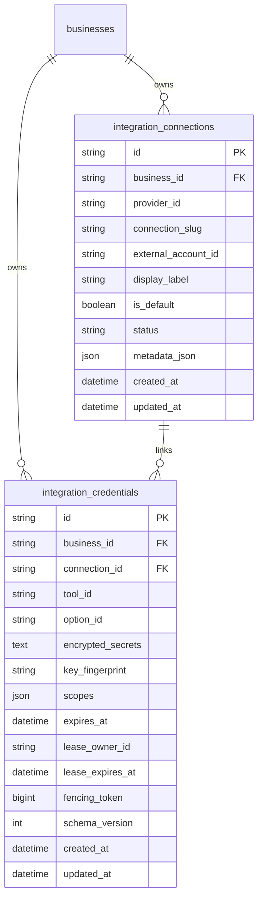
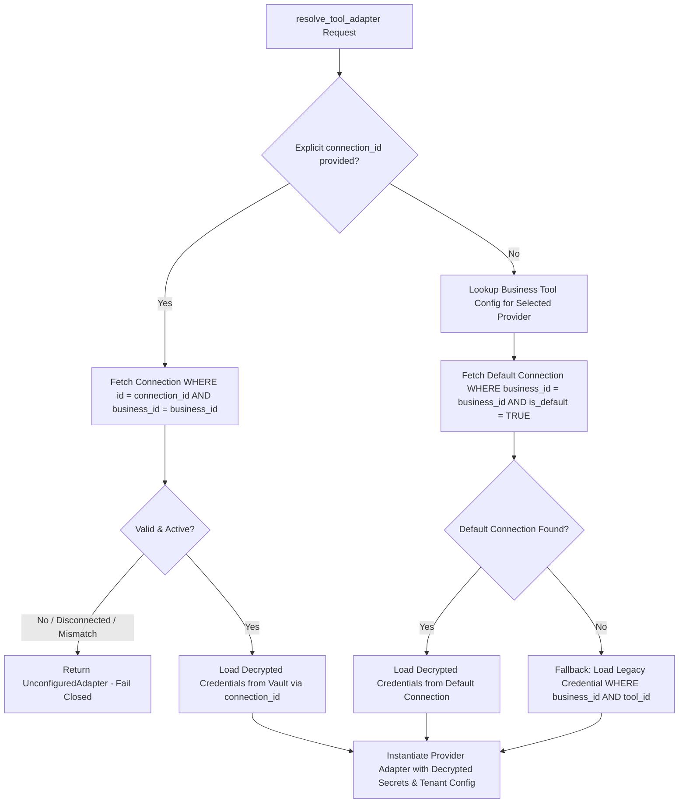
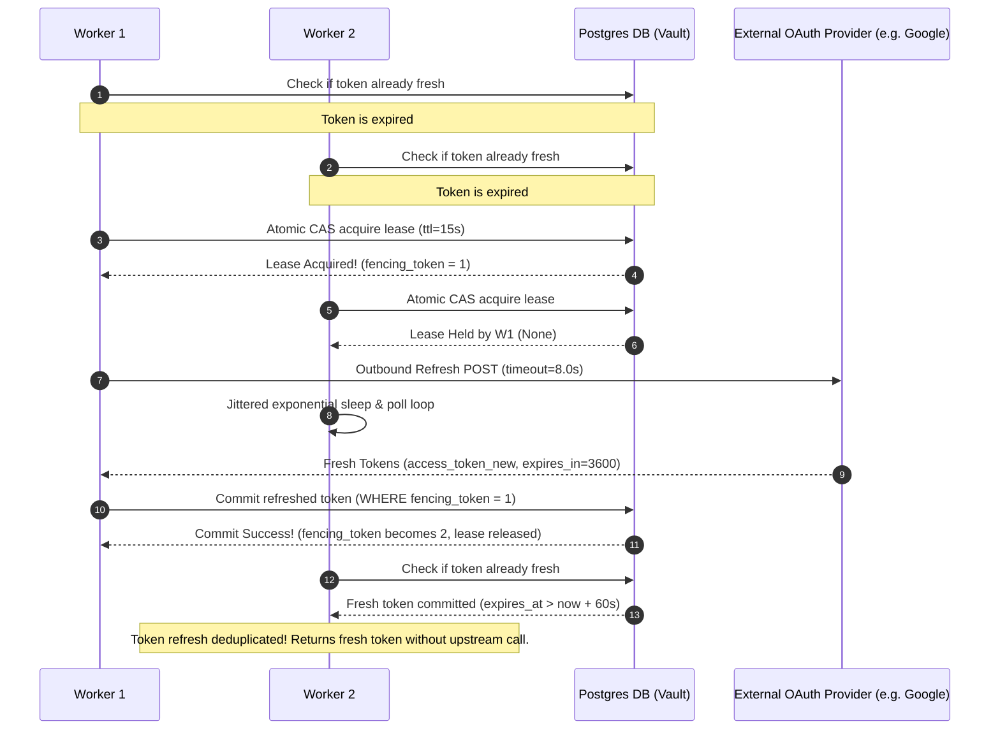

# Integration Credential Management: Architecture, Cryptography & Operator Runbook

## 1. Executive Summary & Core Principles

Answerly is a multi-tenant AI receptionist platform. To automate appointments, reservations, customer messaging, and payments, tenants connect third-party providers (Google Calendar, Stripe Connect, Twilio, SevenRooms, OpenTable, HubSpot, etc.).

Managing third-party credentials in a multi-tenant environment requires strict isolation, defense-in-depth cryptography, and concurrency coordination.

### Core Principles

1. **Defense-in-Depth Cryptography**: All integration credentials at rest are encrypted using authenticated NIST SP 800-38D AES-256-GCM. Plaintext credentials never touch disk unencrypted.
2. **Tenant Isolation**: Every connection and credential is strictly owned by a tenant (`business_id`). Cross-tenant access attempts fail closed and return unconfigured adapters with empty secrets.
3. **Multi-Account Capabilities**: A business tenant may establish multiple independent connections to the same provider (e.g., separate Google Calendars for different doctors in a clinic, multiple Stripe accounts across physical branches).
4. **Distributed Concurrency & Deduplication**: Multiple app workers refreshing OAuth tokens coordinate via database-level atomic Compare-And-Swap (CAS) leases and monotonically increasing fencing tokens. Stale or expired workers can never overwrite fresh credentials.
5. **Zero-Leakage Standard**: Plaintext secrets, tokens, API keys, or private key blocks are never emitted in logs, audit records, CLI outputs, or API response envelopes.
6. **Fail-Closed Production Safety**: Production instances refuse to start without a cryptographically valid 256-bit `CAPABILITY_ENCRYPTION_KEY`.

---

## 2. Threat Model & Security Boundaries

| Threat / Attack Vector | Mitigation in Answerly |
|---|---|
| **Database Compromise (SQL Dump / Backup Leak)** | Stored data is AES-256-GCM ciphertext. Without access to the master key (`CAPABILITY_ENCRYPTION_KEY` or KMS), ciphertext is unrecoverable. |
| **Ciphertext Tampering / Bit-Flipping** | 128-bit authentication tags verified on every read. Tampered ciphertext or authentication tags fail closed (`CredentialDecryptionError`). |
| **Replay / Nonce Collision** | Every encryption operation generates a fresh 96-bit (12-byte) CSPRNG nonce via `os.urandom`. |
| **Cross-Tenant Credential Hijacking** | Database foreign keys, partial unique indexes, repository queries, and adapter resolvers enforce tenant ownership (`WHERE business_id = :tenant_id`). |
| **OAuth Refresh Race Conditions** | Distributed CAS lease acquisition deduplicates concurrent refresh requests; peer workers wait and consume the fresh tokens from the DB rather than hammering upstream OAuth servers. |
| **Zombie Worker Stale Write** | Monotonically increasing fencing tokens validate write authority upon token commit. A worker that stalled beyond its lease TTL cannot overwrite a newer refresh. |
| **Accidental Secret Logging** | Centralized redaction utilities (`redact_credential_dict`, `redact_secret_value`) mask tokens, keys, and passwords before logging or serialization. |

---

## 3. Cryptographic Specification

### 3.1 Algorithm & Parameters

- **Cipher**: AES-256 in Galois/Counter Mode (GCM) adhering to **NIST SP 800-38D**.
- **Key Length**: 256 bits (32 bytes).
- **Initialization Vector (Nonce)**: 96 bits (12 bytes), generated via cryptographically secure pseudo-random number generator (`os.urandom(12)`).
- **Authentication Tag**: 128 bits (16 bytes).
- **Envelope Format (v2)**:
  ```json
  {
    "v": 2,
    "alg": "AES-256-GCM",
    "iv": "<base64_encoded_12_byte_nonce>",
    "c": "<base64_encoded_ciphertext>",
    "t": "<base64_encoded_16_byte_auth_tag>",
    "fp": "<key_fingerprint>"
  }
  ```

### 3.2 Key Derivation, Validation, and Storage

- **Key Material**: Configured via `CAPABILITY_ENCRYPTION_KEY` environment variable.
- **Accepted Encodings**:
  - Standard Base64 (44 characters, ending with `=` or `==`)
  - URL-Safe Base64 (43 or 44 characters)
  - Hexadecimal (64 hexadecimal characters)
  - Raw 32-byte binary or ASCII
- **Entropy & Degeneracy Checks**:
  - Keys composed of uniform or repeating bytes (e.g. `0x00...` or `AAAA...`) are rejected during validation.
  - Human passphrases are rejected unless passed through a proper Key Derivation Function (e.g. PBKDF2/Argon2).
- **Fingerprinting**: Each key has a deterministic SHA-256 fingerprint:
  `fp = "fp_" + sha256(key_bytes).hexdigest()[:16]`
  This enables tracking which master key encrypted each row without exposing key material.
- **Production Validation**: In `production` mode, the FastAPI application fails startup immediately via a Pydantic `@model_validator` in `backend/config.py` if `CAPABILITY_ENCRYPTION_KEY` is missing, placeholder text, or invalid.
- **Python Memory Handling**: Plaintext keys and secrets reside in Python's managed heap. Python's runtime memory management and string immutability mean in-memory copies cannot be guaranteed wiped via `bytearray.clear()`. To minimize risk, key lifetime is kept minimal, secrets are never converted to debug representations, and KMS/HSM key encapsulation is recommended for high-compliance deployments.

---

## 4. Domain Data Model & Persistence



### Invariants Enforced

1. **Unique Slug per Tenant & Provider**:
   `UniqueConstraint("business_id", "provider_id", "connection_slug", name="uq_biz_provider_slug")`
2. **Single Default Connection per Tenant & Provider**:
   Enforced via partial unique index:
   - PostgreSQL: `CREATE UNIQUE INDEX ix_uq_biz_provider_default ON integration_connections (business_id, provider_id) WHERE is_default = TRUE;`
   - SQLite: `CREATE UNIQUE INDEX ix_uq_biz_provider_default ON integration_connections (business_id, provider_id) WHERE is_default = 1;`
3. **Unique External Account ID per Provider**:
   Enforced via partial unique index `external_account_id IS NOT NULL`. Prevents connecting the exact same calendar or Stripe account twice under the same tenant.
4. **Cascade Deletion**: When a business tenant is removed, foreign key cascades cleanly purge all associated connections and credentials.

---

## 5. Multi-Account Support & Credential Resolution

`resolve_tool_adapter(business_id, tool_id, db_service, connection_id=None)` in `backend/integrations/resolver.py`:



---

## 6. Distributed OAuth Token Refresh Coordination

### The Race Condition Problem
When an access token expires on a busy system, dozens of voice calls and API requests may attempt to refresh the token simultaneously. Uncoordinated refreshes result in:
1. Upstream OAuth provider rate limiting (`429 Too Many Requests`).
2. Refresh token invalidation (many providers invalidate the old refresh token immediately upon issuance of a new one; racing workers will fail on subsequent calls).
3. Zombie worker overwrites: A worker that experienced a network delay or GC pause might commit an obsolete token over a newer one.

### Coordination Workflow (`backend/capabilities/oauth_refresh.py`)



### Safety Features

- **Atomic CAS Acquisition**:
  ```sql
  UPDATE integration_credentials
  SET lease_owner_id = :worker_id,
      lease_expires_at = :new_expires,
      fencing_token = fencing_token + 1
  WHERE id = :cred_id
    AND (lease_owner_id IS NULL OR lease_expires_at < :now);
  ```
- **Monotonic Fencing Tokens**: If Worker 1 takes 16 seconds (exceeding its 15-second TTL), and Worker 2 acquires the lease with `fencing_token = 2`, Worker 1's commit (`WHERE fencing_token = 1`) will affect 0 rows and be rejected safely.
- **Bounded HTTP Timeout**: All outbound provider calls are bounded by strict 8.0-second timeouts (`asyncio.wait_for(..., timeout=8.0)`), guaranteeing that workers either finish or fail well within the 15-second lease window.

---

## 7. Integration Disconnection & Crypto-Shredding

When a business disconnects an integration via `CapabilitySetupWizard.disconnect_integration(business_id, tool_id)`:

1. **Decryption of Stored Tokens**: The wizard retrieves and decrypts the active credential material from the vault.
2. **Upstream Provider Revocation**: An HTTP POST is dispatched to the provider's token revocation endpoint (e.g. `https://oauth2.googleapis.com/revoke` for Google Calendar).
3. **Logical Connection Status Update**: The associated `IntegrationConnection` row status is transitioned to `disconnected`.
4. **Live Row Cryptographic Erasure**: The live row in `integration_credentials` (containing the encrypted secret and encrypted DEK) is permanently `DELETE`d from the active database table.
5. **Backup & Retention Note**:
   > [!IMPORTANT]
   > Deleting the live database row removes the credentials from live memory and application queries immediately. However, historical database backups, WAL archives, and replicas retain historical snapshots according to retention policies. True crypto-shredding of historical backups is achieved when rotating the Master Key, which renders all historical ciphertexts permanently unrecoverable across all backup tiers.

---

## 8. Stripe Connect Authentication Architecture

Answerly distinguishes **Platform Credentials** from **Tenant Credentials**:

- **Platform Credentials**: Answerly's own Stripe secret key (`sk_live_...` or `STRIPE_API_KEY`) and webhook signing secrets. These belong strictly to the Answerly platform infrastructure.
- **Tenant Credentials**: Businesses connecting Stripe to receive payments for reservations or appointments authenticate via Stripe Connect.
- **Authentication Execution**:
  - The Stripe API client uses Answerly's platform secret key for API requests.
  - Tenant requests include the tenant's connected account ID via the `Stripe-Account: acct_...` header.
  - A connected account ID alone does **not** provide authorization without the platform key. Both are required and verified on every payment operation.

---

## 9. Resumable Migration Tooling & Operator Guide

`backend/capabilities/migration_tool.py` provides automated migration from legacy v1 credential envelopes to v2 AES-256-GCM.

### CLI Usage

```bash
# 1. Preview changes without modifying the database (DRY-RUN)
python -m backend.capabilities.migration_tool --dry-run

# 2. Execute live migration with standard markdown output
python -m backend.capabilities.migration_tool

# 3. Output structured JSON for automated audit pipelines
python -m backend.capabilities.migration_tool --json > migration_report.json

# 4. Migrate with a specific master key
python -m backend.capabilities.migration_tool --key "k7L...="
```

### Sample Redacted Audit Output

```markdown
# Credential Vault Migration Report: SUCCESS
**Execution Mode:** `LIVE MIGRATION (Committed to Database)`  
**Started At:** `2026-10-27T22:00:00.123456+00:00`  
**Completed At:** `2026-10-27T22:00:00.250123+00:00`  
**Duration:** `0.127s`  

## Summary Metrics
- **Total Records Inspected:** 42
- **Migrated:** 42
- **Skipped (Already Migrated):** 0
- **Failed:** 0

## Record Audit Trail
| Credential ID | Business ID | Tool ID | Provider | Connection ID | Status | Reason / Error |
|---|---|---|---|---|---|---|
| `cred_a1b2c3` | `biz_clinic` | `check_availability` | `google_calendar` | `conn_998877` | **MIGRATED** | Re-encrypted legacy ciphertext to AES-256-GCM v2; Synthesized and linked default connection; Advanced schema_version to 2 |
```

---

## 10. Key Rotation Playbook

To rotate the `CAPABILITY_ENCRYPTION_KEY` in production with zero downtime:

1. **Generate New Key**:
   ```bash
   python -c "from backend.capabilities.vault import generate_vault_key; print(generate_vault_key())"
   ```
2. **Execute Rotation via Migration Engine**:
   - Run a migration script passing the old key as the active key and the new key as the re-encryption target.
   - For each credential:
     - Decrypt with Old Key.
     - Re-encrypt with New Key (generates fresh nonce, tag, and new fingerprint).
     - Update `key_fingerprint` and `encrypted_secrets`.
3. **Deploy New Key Configuration**:
   - Update `CAPABILITY_ENCRYPTION_KEY` in secret manager / production `.env`.
   - Perform zero-downtime rolling restart of backend workers.
4. **Retire Old Key**:
   - Once all rows reflect the new `key_fingerprint` in database metrics, the old key can be safely retired.
